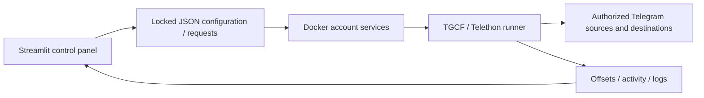

# Telegram Forward / Backup Tool

A self-hosted Telegram forwarding and history-backup tool with Docker workers and a Streamlit control panel.

**Based on [TGCF by Aahnik Daw and its contributors](https://github.com/aahnik/tgcf), with substantial modifications for multi-account operation, backup scheduling, progress recovery, and day-to-day administration.** TGCF provides the original forwarding engine, live/history modes, web interface, and plugin system. This project builds on that work; upstream attribution and the MIT license are retained in [NOTICE](NOTICE.md) and [LICENSE](LICENSE).


## Added features and major modifications

- A dedicated Docker-owned scheduler for each account, plus a service for additional accounts.
- Catch-up backups, one-time history copying and live forwarding controls.
- Connection-to-account assignments, per-account pauses and per-connection controls.
- A joined-chat list that distinguishes source backups from receivers, with destinations, account assignment and worker/paused status.
- One shared dump destination for miscellaneous chats, with bulk setup and an option to add it to existing topic routes without resetting progress.
- Weighted normal/dump queues with configurable time shares and session limits, persistent rotation, and cooldown handling that keeps later routes reachable.
- Saved offsets, progress reports, activity history and Telegram FloodWait visibility, with retries of the same message after rate limits.
- Recovery from oversized media captions: preserve the file and send the complete caption in text replies.
- Native invoice forwarding and automatic progress past empty history entries, so these message types do not block a backup.
- File locks, atomic JSON writes and merge-aware configuration updates to reduce concurrent-write conflicts.
- A password-protected Streamlit interface with session expiry and session-local login throttling.

This is a forwarding service, not a chatbot. It depends on authorized Telegram accounts and on access to each source and destination. Telegram permissions, protected content and rate limits still apply. Copy only material you have permission to copy.

## Quick start

```sh
git clone https://github.com/mantaspeciukevicius/message-workflow-manager.git
cd message-workflow-manager
python3 scripts/configure.py
# Optional: set LAN_IP in a root .env to expose the UI on your trusted LAN.
docker compose up -d --build
```

The initial UI binds to loopback at `http://127.0.0.1:8501`. The generated dashboard password is in `app/.env`. The application refuses the upstream default password `tgcf`.

1. Sign in to the dashboard.
2. Open Telegram Login and supply your own API ID/hash from [my.telegram.org](https://my.telegram.org/), then complete the account login or supply an authorized session.
3. In Multi User, add additional accounts if needed. Session strings are equivalent to credentials: keep them private.
4. In Connections, select a source, destinations and assigned account. Confirm that the account can read the source and write to each destination.
5. Open Backup Control to choose scheduled catch-up, a single catch-up, or LIVE forwarding. Check status and logs before widening the scope.

Do not reset offsets to zero unless you intend to repeat history; that can duplicate messages. Exact once-only delivery across Telegram/network failures is not guaranteed. A successful container start alone does not prove forwarding is configured.

## How it works



The UI queues work instead of launching forwarding processes. Workers retain progress and report status through files in the persistent `app` bind mount. Configuration and session files are deliberately excluded from this repository. Screenshots use synthetic accounts and connections with no Telegram session, and no forwarding worker is run for screenshots.

## Chat coverage and shared dump

In **Connections**, select an account and load its joined chats. The list shows whether a source backup route is configured, where messages go, and whether it is currently running, scheduled, paused, disabled or unavailable. Receiving copies is distinct from being backed up as a source.

Set **Shared dump chat** once by picking a joined chat or entering its ID/username. Select miscellaneous source chats in **Quick backup to dump**, then submit the selection. New routes are enabled, assigned to that account and begin history at message zero. They enter the existing worker’s next cycle. Account/route pauses and current worker modes remain unchanged.

Optionally include existing backups: the dump is added as another destination while the topic destination and saved offset are retained. Only messages handled after the next worker cycle go to the new destination; old history is not automatically copied there. Changing or clearing the default dump does not retarget or delete existing routes.


Duplicate submissions are idempotent, conflicting edits are rejected, and self/transitive forwarding loops are detected using known chat aliases. Each assigned account still needs access to the source and permission to post to the dump. See [setup and troubleshooting](docs/HOWTO.md) for the full workflow.

More interface views: [screenshot gallery](docs/SCREENSHOTS.md).

## Operations and recovery

```sh
docker compose ps
docker compose logs --tail 100 tgcf-user1
docker compose up -d --build
```

Services use `restart: unless-stopped`. For a consistent backup, pause jobs, let them save offsets, then stop the stack before archiving the private `app` state; restart afterward. Keep credentials, session strings, offsets and connection assignments together in an encrypted backup. A source checkout alone cannot restore your Telegram login or forwarding progress.

See [setup and troubleshooting](docs/HOWTO.md), [validation](docs/VALIDATION.md), and the [LinkedIn project summary](docs/PORTFOLIO.md).

Quick backup to dump now defaults to **Hide chats used as sources or destinations**. This excludes chats referenced anywhere in configured routes, including disabled routes and routes assigned to other accounts. Uncheck it to show available destinations; also enable the existing-backups option when adding the dump to an existing source route. Existing destinations and offsets are preserved.

### History scheduling priorities

Backup Control → **History backup priorities · normal / dump** configures the normal time share (default 70%, minimum 50%), normal session limit (70 minutes), dump session limit (30 minutes), and which routes belong to the lower-priority queue. Settings apply at the next turn. Newly created quick-dump routes default to dump priority; existing topic routes remain normal when another destination is appended.

Each account schedules its own two queues. Actual elapsed time determines fairness, independently of route counts. Within each queue, routes take turns. While both queues have runnable history work, the long-run share follows the configured percentage; individual turns can temporarily differ. Spare capacity is available to the other queue when a queue is empty or finished. Completed routes have a five-minute cooldown; timed-out routes resume from their saved offsets. Paused, disabled and reassigned routes are filtered before each turn. Run-once visits every selected route once; live forwarding is unchanged.

Queue usage, interrupted-turn checkpoints and cursors persist in private sidecars. No offset resets or Telegram rate-limit bypasses are introduced.

### History forwarding recovery

History queue rotation retains its position when completed routes temporarily leave the eligible queue. Later backups therefore still receive their turns.

If Telegram rejects a media caption as too long, the file is copied with an empty caption and the full caption text is sent as plain-text replies, split at Telegram's text limit. Already accepted file and text sends are retained during FloodWait retries. Invoice messages use native forwarding because Telegram invoices cannot be uploaded as files; this does not make or authorize a payment. Empty history entries with no text or media advance the saved offset without sending an empty message.

These fixes were verified against running backup routes, including successful transfers after an oversized caption, an invoice, and an empty history entry. Destination IDs, credentials, route assignments, and progress remain private deployment state and are not included in this repository.
