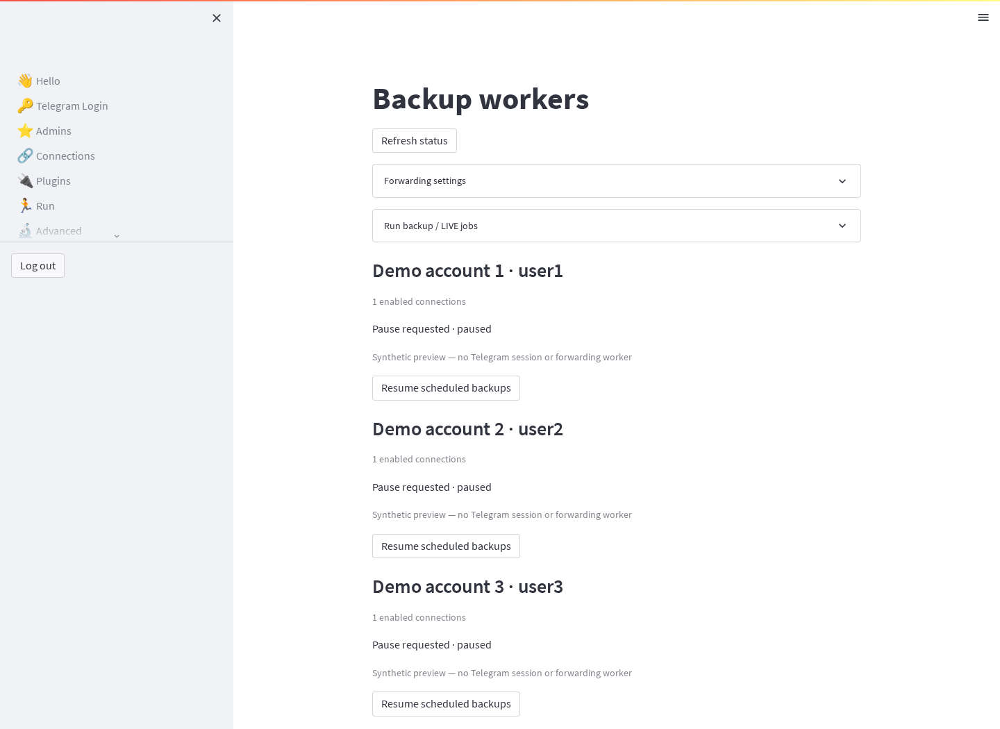
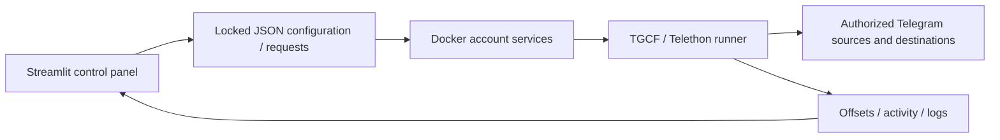
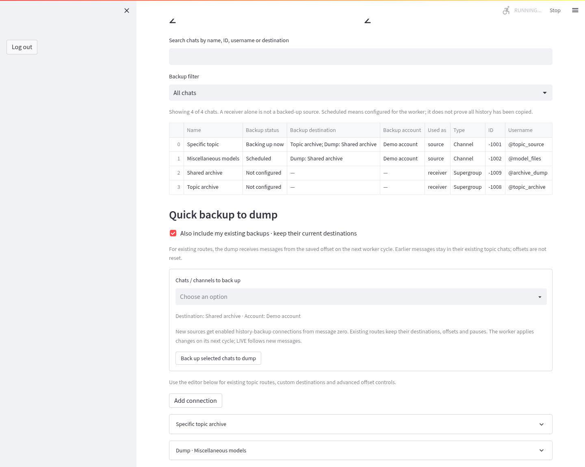

# Message Workflow Manager

A Docker-deployed, multi-account Telegram forwarding and history-copying service with a Streamlit control panel. This project extends [aahnik/tgcf](https://github.com/aahnik/tgcf); upstream authorship and the MIT license are preserved in [NOTICE](NOTICE.md) and [LICENSE](LICENSE).



## Local extensions

- A dedicated Docker-owned scheduler for each account, plus a service for additional accounts.
- Catch-up backups, one-time history copying and live forwarding controls.
- Connection-to-account assignments, per-account pauses and per-connection controls.
- A joined-chat list that distinguishes source backups from receivers, with destinations, account assignment and worker/paused status.
- One shared dump destination for miscellaneous chats, with bulk setup and an option to add it to existing topic routes without resetting progress.
- Saved offsets, progress reports, activity history and Telegram FloodWait visibility.
- File locks, atomic JSON writes and merge-aware configuration updates to reduce concurrent-write conflicts.
- A password-protected Streamlit interface with session expiry and session-local login throttling.

This is a forwarding service, not a chatbot. It depends on authorized Telegram accounts and on access to each source and destination. Telegram permissions, protected content and rate limits still apply. Copy only material you have permission to copy.

## Quick start

```sh
git clone https://github.com/mantaspeciukevicius/message-workflow-manager.git
cd message-workflow-manager
python3 scripts/configure.py
# Optional: set LAN_IP in a root .env to expose the UI on your trusted LAN.
docker compose up -d --build
```

The initial UI binds to loopback at `http://127.0.0.1:8501`. The generated dashboard password is in `app/.env`. The application refuses the upstream default password `tgcf`.

1. Sign in to the dashboard.
2. Open Telegram Login and supply your own API ID/hash from [my.telegram.org](https://my.telegram.org/), then complete the account login or supply an authorized session.
3. In Multi User, add additional accounts if needed. Session strings are equivalent to credentials: keep them private.
4. In Connections, select a source, destinations and assigned account. Confirm that the account can read the source and write to each destination.
5. Open Backup Control to choose scheduled catch-up, a single catch-up, or LIVE forwarding. Check status and logs before widening the scope.

Do not reset offsets to zero unless you intend to repeat history; that can duplicate messages. Exact once-only delivery across Telegram/network failures is not guaranteed. A successful container start alone does not prove forwarding is configured.

## How it works



The UI queues work instead of launching forwarding processes. Workers retain progress and report status through files in the persistent `app` bind mount. Configuration and session files are deliberately excluded from this repository. Screenshots use synthetic accounts and connections with no Telegram session, and no forwarding worker is run for screenshots.

## Chat coverage and shared dump

In **Connections**, select an account and load its joined chats. The list shows whether a source backup route is configured, where messages go, and whether it is currently running, scheduled, paused, disabled or unavailable. Receiving copies is distinct from being backed up as a source.

Set **Shared dump chat** once by picking a joined chat or entering its ID/username. Select miscellaneous source chats in **Quick backup to dump**, then submit the selection. New routes are enabled, assigned to that account and begin history at message zero. They enter the existing worker’s next cycle. Account/route pauses and current worker modes remain unchanged.

Optionally include existing backups: the dump is added as another destination while the topic destination and saved offset are retained. Only messages handled after the next worker cycle go to the new destination; old history is not automatically copied there. Changing or clearing the default dump does not retarget or delete existing routes.



Duplicate submissions are idempotent, conflicting edits are rejected, and self/transitive forwarding loops are detected using known chat aliases. Each assigned account still needs access to the source and permission to post to the dump. See [setup and troubleshooting](docs/HOWTO.md) for the full workflow.

More interface views: [screenshot gallery](docs/SCREENSHOTS.md).

## Operations and recovery

```sh
docker compose ps
docker compose logs --tail 100 tgcf-user1
docker compose up -d --build
```

Services use `restart: unless-stopped`. For a consistent backup, pause jobs, let them save offsets, then stop the stack before archiving the private `app` state; restart afterward. Keep credentials, session strings, offsets and connection assignments together in an encrypted backup. A source checkout alone cannot restore your Telegram login or forwarding progress.

See [setup and troubleshooting](docs/HOWTO.md), [validation](docs/VALIDATION.md), and the [LinkedIn project summary](docs/PORTFOLIO.md).

Quick backup to dump now defaults to **Hide chats used as sources or destinations**. This excludes chats referenced anywhere in configured routes, including disabled routes and routes assigned to other accounts. Uncheck it to show available destinations; also enable the existing-backups option when adding the dump to an existing source route. Existing destinations and offsets are preserved.
